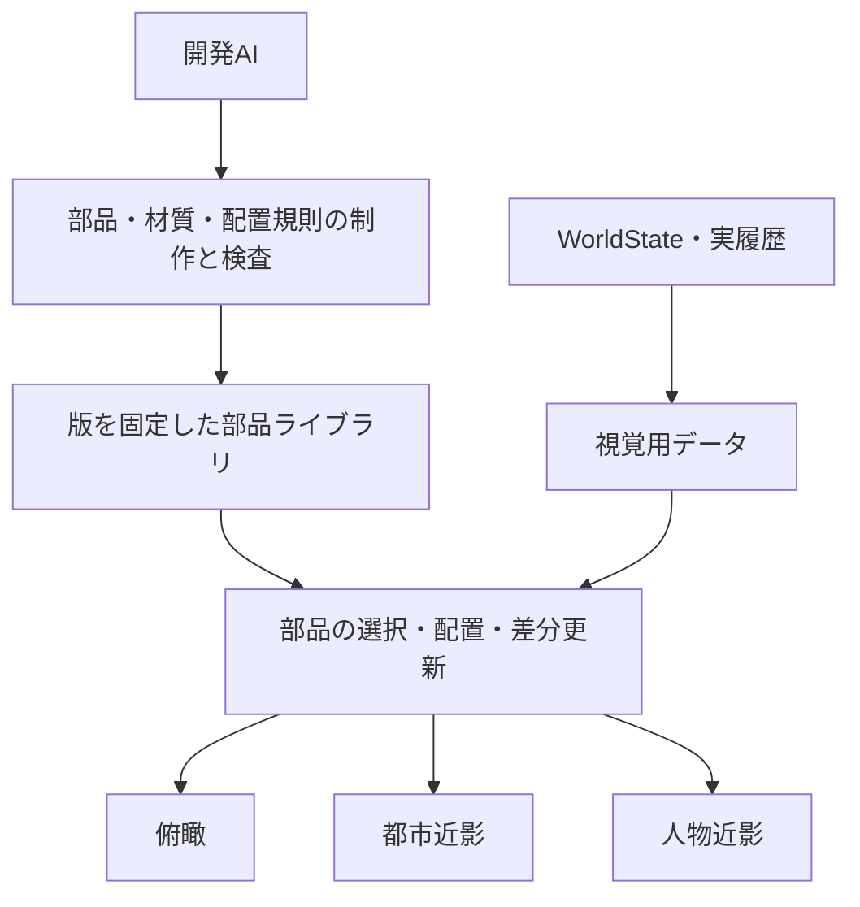

# Chronofork 視覚生成システムの要件・技術調査

更新日: 2026-11-19  
状態: **ユーザーが示した検討方針と将来構想の記録／技術構成・グラフィックMVPは提案段階**  
確認した正本: `main` `5dd99cc208fa661c15fb76216d4d71d8d3fe528f`

## 1. この資料の役割と今回の修正

この資料は、完成形のChronoforkに必要な視覚生成を検討するための領域資料である。ゲーム全体のMVP『亡国の王冠』の既存実装範囲を、そのままグラフィックの最終要件にしない。完成形の要件を先に整理し、重要な不確実性を検証できるグラフィック側のMVPを後から切り出す。

2026-11-19のユーザー指示により、先行調査の「現在のゲームMVPに必要な固定素材を中心に候補を選ぶ」という検討順序を置き換える。以前のツール調査は参考にできるが、MVPへの即時適合だけで最終的な表現・技術候補を除外しない。

### 確定度の区別

| 区分 | 内容 | 扱い |
|---|---|---|
| 今回の明示的な作業指示 | 完成形を起点に要件を再整理し、その後にグラフィックのMVPを決める。開発コンテクストを保存し、技術調査をやり直す | 本調査の進め方として適用 |
| ユーザーが示した最終方向 | 多数の変数で世界線をシミュレーションするゲームに、視覚的な自動生成も組み込みたい。俯瞰・都市近影・人物近影等を生成し、そのためのグラフィックパーツをAIに作成させたい | 要件検討の与件。全機能の即時実装承認ではない |
| 先行して示された制作運用 | ChatGPT等のAIから生成・ローカル修正までつなぎ、人間が最終成果物を確認する。Blenderの利用を検討している | 制作工程の目標。Blenderの正式採用や完全ローカル推論の確定とは扱わない |
| この資料の設計提案 | 視覚用データ、部品規格、安定ID、差分更新、候補ツール、グラフィックMVP、評価方法 | アシスタント提案。採用・実装済みではない |
| 継続して未決 | 最終画風、2D／2.5D／3Dの表示方式、投影方式・近影のカメラ、エンジン、対応機器、許容待ち時間、費用、ライセンス、具体的な文明・文化規則 | 比較と小規模検証で判断。既存仕様へ自動反映しない |

既存の上位体験方針と構想は[体験ビジョン・UI構想](experience-and-ui-ideas.md)を参照する。時代への没入、注目外の変化の発見、事実に基づく歴史比較との整合を重視する。

関連する[美術制作方針のPR #136](https://github.com/squne121/chronofork/pull/136)は、確認時点では未統合。Gemini Chatの優先利用・用途別ツール・API/MCP等の記録を含むが、この資料はそのPRを取り込まず、最終絵柄やツール採用を追加確定しない。統合状況は後続作業で確認する。

### 世界俯瞰カメラとイベント演出の補足（2026-11-19）

以下はユーザーが追加で明示した検討条件。世界俯瞰や3Dの採用決定には拡大しない。

- 3Dグラフィックは現時点で要件として確定していない。
- 世界俯瞰視点を採用する場合、平行移動と視点距離の移動は想定するが、カメラの角度は変えない。
- 建物の裏側を見る操作や、人の営みを常時アニメーションで表現することは想定していない。
- 戦争・火災・天災などのイベントアニメーションは採用する可能性が高い。個別の演出方式は未採用。
- この条件から、都市近影・人物近影の投影方式、画角、遷移まで自動的に確定しない。

**技術整理（提案）:** 固定角度の俯瞰、画面の平行移動、拡大縮小、イベント演出は、2D部品合成でも成立する。GodotのCamera2Dはスクロールとzoomを提供し、2Dパーティクルには炎・煙・爆発等の表現がある [T26](https://docs.godotengine.org/en/stable/classes/class_camera2d.html)[T27](https://docs.godotengine.org/en/stable/tutorials/2d/particle_systems_2d.html)。

「視点距離の移動」が画面上の拡縮を意味するか、透視投影カメラを空間内で移動させる意味かは区別する。正投影ではカメラからの距離で見かけの大きさが変わらず、表示範囲・zoomを変更して拡縮する [T28](https://threejs.org/docs/pages/OrthographicCamera.html)。透視投影でカメラを実際に移動すると、角度を固定しても奥行きに応じた相対位置・倍率・見える面が変わり得るため、単一の2D画像の平行移動・拡縮とは一致しない。透視投影そのものの採用は未決である。

**比較方針（提案）:** 2D／2.5Dの部品合成と、固定角度の実行時3Dを比較する。Blender等で3D制作して固定方向の2D素材を書き出す方式も候補。制作に3Dを使うこと、地形等に高さデータを持つこと、実行時に3D描画することは別々に判断する。

## 2. 完成形で必要なのは「世界状態を描くシステム」

固定の都市絵・人物絵を有限枚数用意するだけでは、多数の世界線、年代、個体、状態の組合せを扱えない。完成形では、世界の状態から意味のある視覚データを導き、共通の部品と配置規則で場面を作る仕組みが必要になる。

ここでの「自動生成」は、次の3工程を含む。

1. **制作時の生成:** AIが部品、材質、バリエーション、配置規則、制作スクリプトを作り、検査して登録する。
2. **ゲーム実行時の生成:** 世界状態に合わせて登録済みの部品を選択・組み立て・描画する。
3. **必要時の追加生成:** 足りない部品や景観を非同期で生成し、検査後に保存・再利用する。完成形の拡張候補であり、毎回の閲覧に外部AI呼出しを必須化しない。

人間が最終確認する運用は、制作した部品、生成規則、代表的な組合せ、ゲーム内での見え方を承認する工程として設計する。発売後に生成される全世界線の全画像を人間が事前承認する運用は成り立たないため、実行時には構造検査と代替表示も必要になる。

### 完成形から導いた要件案

| 要素 | 必要な性質 | 具体的に確かめること |
|---|---|---|
| 世界状態との対応 | 何が存在し、どう変化したかをシミュレーションの事実から導く | 存在しない港・戦災・人物を画像側が事実として追加しない |
| 複数の視点 | 俯瞰・都市近影・人物近影が同じ対象を参照する | 地図の都市・近景の道路や塔・人物の所属先が対応する |
| 個体の同一性 | 同じ都市・建物・人物を再訪して識別できる | 再読込や部品追加だけで顔・都市骨格が変わらない |
| 時間と世界線 | 共通の過去と、分岐後に変わった部分を区別する | 分岐直後の共通部分が一致し、無関係な個体が再抽選されない |
| 変数から見た目への変換 | 直接反映・間接反映・非表示・未定義を明示する | 数値を変えた理由と、変わった表示の根拠を追える |
| 世界の多様性 | 地理、文化、文明段階、産業等に応じた部品と規則を差し替えられる | 特定の湾・川・丘や地球上の単一時代を全都市へ固定しない |
| 部品の互換性 | 寸法、接合、色調、材質、リグ、詳細度を合わせる | AIが別々に作った屋根と壁、服と人体を正常に組み合わせられる |
| 局所的な修正 | 指定部分を変えて他の部分を保てる | 屋根修正が道路網、衣装変更が基本顔形状を変えない |
| 再現・保存 | 採用結果、入力、生成器、依存資産の版を追跡する | 過去の世界線を再訪して当時の外観を復元できる |
| 実行時の応答 | 視点・観測対象・状態変化に応じた必要分だけを処理する | LOD、インスタンス描画、差分更新、キャッシュ、生成待ちを評価する |
| 読みやすさと美術 | 世界の変化が読み取れ、全体の画風が揃う | 雰囲気の良さと、歴史比較・調査の分かりやすさを別々に確認する |
| 自動運用 | API／CLI／MCPから実行し、失敗箇所を特定・修正できる | 上限のある再試行、取消、ログ、代替資産、費用計測がある |
| 配布と利用条件 | ツール、モデル、素材、生成物の条件を区別できる | 配布対象と再利用条件を資産単位で確認する。ライセンス方針自体は別途判断 |

「多くの変数」を、そのまま長いプロンプトへ列挙する方式にはしない。どの変数が、どの外観要素へ、どの条件で影響するかを仕様として持つことが重要である。

### 変数と視覚の対応例

以下の値・現象は将来の対応例であり、現在のWorldStateにすべて実装済みという意味ではない。

| 状態・条件の例 | 視覚へ反映する候補 | 保持するもの・注意 |
|---|---|---|
| 人口や都市規模 | 建物密度、地区の広がり、代表的な群衆量 | 人口1人につき1体を描く義務はない。代表表示の密度と実人数を混同しない |
| 建材・技術・文化 | 建築キット、屋根、窓、装飾、衣装 | 文化から身体形状や能力を推定する規則を新設しない |
| 経済的状態・維持状態 | 建材の更新、補修、設備、風化 | 貧富から無根拠に健康・人格・歴史事実を描き足さない |
| 記録された損傷・再建 | 対応する建物や部位の状態 | 戦争があるだけで橋の焼失を創作しない。個別の損傷が未モデル化なら橋の消失や通行不能を示す描写は避け、機能を変えない一般的な風化等の装飾と区別する |
| 年齢・選択済み外観 | 加齢用の形状・材質、髪、服、姿勢 | 同一人物の基本外観を共有。加齢による能力変化や遺伝規則を導入しない |
| 支配・所属の変化 | 根拠のある旗、紋章、制服等 | 所属変更だけで顔や地形を作り替えない |
| シミュレーション上は重要だが不可視の数値 | 図表、注記、状態表示、または表示しない | すべての内部変数に物理的な見た目を捏造しない |

## 3. 推奨する構成案

仮称として、世界状態を描画向けに変換したデータを「視覚用データ」と呼ぶ。新しいゲーム規則の正本ではなく、表示のための投影である。

### 3.1 シミュレーションと装飾の境界

- **事実:** 都市・人物の存在、位置、所属、記録された出来事等。シミュレーション側を参照する。
- **表示上の派生:** 都市規模から導いた代表的建物数、遠景の群衆、未モデル化の窓や小物等。表示用IDと生成規則を保持する。
- **演出:** カメラ、照明、筆致、色調、ポーズ等。比較モードでは条件を揃える。

表示側が補った家屋を、正式な課税対象や歴史イベントの主体としてシミュレーションへ逆輸入しない。後に個々の建物をゲーム上の実体へ昇格する場合は、別の規則・データ設計になる。

人物近影も、都市内の全群衆と1対1対応させる必要があるかは未決。少なくとも選択中の人物とその近影は同じ人物IDを参照する。

### 3.2 同一性と時間変化

- 基本外観は、安定した個体ID・初期外観値・部品参照で管理する。
- 世界線IDや現在年を全外観の乱数seedに直接混ぜない。共通の過去を持つ個体は基本外観を共有する。
- 初めて観測・詳細生成する順序によって基本外観を変えない。分岐前には未表示だった共通個体も、各世界線で同じ基本外観を参照し、分岐後の状態差だけを反映する。
- 新規に生じた個体のID・分岐との対応はゲーム側の規則に従う。存在しない個体対応を見た目の類似だけで推定しない。
- 配列の順番や一つの大域的な乱数列へ依存しない。顔、髪、建物配置、小物等は目的別に乱数・参照を分ける。
- 都市を各年に無関係に作り直さず、道路・区画・建物の継続を扱う。必要なら視覚用の建設・更新履歴を保存し、スナップショットとの関係を定義する。
- 生成器・部品カタログ・モデルの版を固定する。更新後に既存世界を移行するか、以前の版で再生するかを選べるようにする。

意味的な再現性と、ピクセル単位で完全一致する再描画は別の要件である。描画環境が異なっても同じ個体・配置・材質選択を維持することを先に確認する。画像の完全一致が必要な用途では、レンダー環境の固定または採用画像の保存を併用する。

### 3.3 ビューの共通性

俯瞰と都市近影は、共通の地理・道路・建物配置を参照する。人物は共通の顔・体型・髪・衣装データを参照する。カメラ変更を、新しい場面の再抽選として扱わない。

距離によって形状や表示量を簡略化するLODは、同じ個体の別表現として管理する。「複数ビューが整合すること」と「地表から顔まで連続ズームできること」は別の要求であり、後者は未確定である。

比較モードでは、カメラ、照明、季節等の演出条件を揃え、実際の状態差と描画条件の差を混同しない。必要に応じて表示条件を変えられる通常観測とは分ける。

### 3.4 実行時と追加生成

高速な描画は、事前制作した部品の選択・配置を中心にする。新しいAI生成が必要な場合は非同期ジョブにし、生成結果・出典・入力・版を保存する。同じ場面の再訪で同じジョブを重複実行しない。

部品選択・配置のキャッシュは、個体ID、視覚的に関係する状態、部品と生成器の版で識別する。レンダー画像のキャッシュには、これにカメラ・照明・解像度等を加える。カメラ変更だけで世界の構造を再生成せず、無関係な変数の変化で全キャッシュを無効化しない。

再試行回数、待ち時間、費用の上限を設定し、失敗時は承認済みの近似部品や簡略表示へ戻す。具体的な数値は対象機器と品質を計測して決める。

## 4. AIに作らせる「部品」の範囲

部品はPNGや3Dモデルだけに限定しない。再利用できる生成器や、部品を組み合わせる規則も含む。

| 分類 | 例 | 共通規格 |
|---|---|---|
| 地形・自然 | 地表材質、岩、植物、水際、地形生成ノード | 単位、座標、密度、植生・地形条件、遠近の表現 |
| 都市骨格 | 道路断面、区画、街区、広場、建物配置ルール | 接続点、通行空間、地形適合、敷地境界 |
| 建築 | 壁、屋根、柱、窓、扉、塔、橋、装飾 | 寸法、原点、接合面、用途、年代・様式タグ、損傷差分 |
| 人物 | 基本人体、顔パラメータ、髪、衣装、装身具、表情、ポーズ | 骨格、体型範囲、遮蔽、重なり、材質、LOD |
| 表層・演出 | テクスチャ、風化、色差、光、煙等 | 色空間、材質チャンネル、適用条件、比較時の固定条件 |
| 生成規則 | Geometry Nodes、配置グラフ、形状文法、モーフ設定、スクリプト | 入出力、対応版、seed／ID規則、検査、上限、失敗時の動作 |

資産の記録には、ID・版・用途・適合条件・出典・利用条件・生成レシピ・検査結果を持たせる。多数の独立した管理文書を作るのではなく、実際に組立と検査に使うカタログへ集約する案がよい。

3Dの場合は頂点数だけでなく、マテリアル数、テクスチャ容量、UV、接合、コライダーの要否、書出し後の見え方も検査する。2Dの場合はキャンバス、基準点、方向、透過、前後関係、パレットを検査する。見た目の改善で他の部品との互換性を失わないことが重要である。

## 5. 技術調査と候補の役割

以下は2026-11-19に公式ドキュメント・作者のリポジトリを確認した結果である。**公開機能の確認と、Chronofork環境での動作・速度・品質の検証を区別する。後者はすべてUNVERIFIED。**

### 5.1 優先比較する構成要素

| 候補 | AIとの接続と役割 | 制作時／実行時・実行場所 | 評価・制約 |
|---|---|---|---|
| **Blender＋Geometry Nodes／Python** | 形状・配置・材質・レンダー・出力をスクリプト化。Blender LabのMCPも公開 [T1](https://docs.blender.org/api/5.1/info_tips_and_tricks.html)[T2](https://www.blender.org/lab/mcp-server/) | ローカルの部品制作、規則制作、バッチ描画 | **制作基盤の第一候補。** 保存済みシーンから複数視点を出せる。Geometry Nodesを他エンジンへそのまま移植できる前提にはしない |
| **MPFB＋MPFB MCP** | 人体、モーフ、衣装、リグ、表情、ポーズ、プリセット、出力を定義済みツールで操作 [T3](https://github.com/makehumancommunity/mpfb-mcp) | Blender上での人物制作・バッチ生成 | **人物の第一比較候補。** MakeHuman Community配布。MCPはEarly beta・42ツール。品質と互換性は要検証 |
| **ComfyUI＋Krita AI Diffusion** | ワークフローによる画像生成・編集、参照画像、材質や衣装差分、レイヤー／マスク編集 [T4](https://github.com/Comfy-Org/workflow_templates)[T5](https://github.com/Acly/krita-ai-diffusion) | モデルによりローカル／外部。制作時中心、必要時非同期にも利用可能 | 部品と表層を作る担当。Kritaプラグインは編集統合であり、無人品質保証そのものではない |
| **Hunyuan3D-2.1** | 画像から3D形状とPBR材質を作るコード・モデル [T6](https://github.com/Tencent-Hunyuan/Hunyuan3D-2.1) | ローカル／GPUサーバーでの候補部品生成 | 屋根・小物等の候補制作。生成結果が規格適合・最適化・リグ済みとは扱わず、Blender側で検査・調整する |
| **Unreal PCG＋Unreal MCP** | 実行時の手続き生成、階層グリッド、編集時のAIによる生成グラフ操作 [T7](https://dev.epicgames.com/documentation/unreal-engine/using-pcg-generation-modes-in-unreal-engine)[T8](https://dev.epicgames.com/documentation/unreal-engine/working-with-pcg-and-llms-using-unreal-mcp-in-unreal-engine) | ゲーム実行時のPCGと、開発時のMCPを分離 | 動的3D世界の有力候補。MCP／LLM機能はExperimental。WorldState変換と履歴保存は独自実装 |
| **Three.js／Godot** | コードからシーン、メッシュ、部品配置、インスタンス描画を扱う [T9](https://threejs.org/docs/pages/InstancedMesh.html)[T10](https://docs.godotengine.org/en/stable/tutorials/3d/procedural_geometry/index.html) | ブラウザまたはゲームアプリで実行時描画 | 部品を状態から組み立てる軽量な試作候補。生成規則・履歴・ツール連携は開発が必要 |
| **Spine Runtime Skins** | 2D人物の髪・衣装等をプログラムで合成 [T11](https://en.esotericsoftware.com/spine-runtime-skins) | 部品制作後、実行時に合成・アニメーション | 2D人物を選ぶ場合に有用。任意の角度へ回れる3D人物の代替とは限らない |
| **MetaHuman Collection／Instance** | 事前構築したCollectionから髪・衣装等を選んで人物を組立 [T12](https://dev.epicgames.com/documentation/metahuman/metahuman-instances-in-unreal-engine) | UEのcooked build内でruntime assembly可能 | 高精細3D人物の比較候補。確認資料ではExperimental。任意の顔を実行時に自由生成できる意味ではない |

### 5.2 拡張・研究の比較対象

| 候補 | 利用する価値 | 境界 |
|---|---|---|
| **Houdini／Houdini Engine** | 高度な地形・建築生成器をHDAとして制作・利用 [T13](https://www.sidefx.com/products/houdini-engine/plug-ins/unreal-plug-in/) | 公式Unrealプラグインはランタイム用ではない。制作時の生成器として比較 |
| **Infinigen** | Blenderベースの自然物・材質・部品生成コード [T14](https://github.com/princeton-vl/infinigen/blob/main/docs/source/GeneratingIndividualAssets.md) | 部品生成器の参考。外部出力ではベイクが必要。全シーン出力はUSDCのみ公式対応、アニメーション出力は未検証で、公式サポート外 [T15](https://github.com/princeton-vl/infinigen/blob/main/docs/source/ExportingToExternalFileFormats.md) |
| **OpenUSD** | 共有部品、レイヤー、variants、非破壊override、payload等 [T16](https://openusd.org/release/intro.html) | DCC間の大規模な資産構成に有用。永続GUIDを提供せず、ゲームの個体IDや分岐履歴は別に管理する。初期検証の必須基盤にはしない |
| **World Labs Atlas** | カメラ・深度付き生成、新視点、マスク編集、splats／meshへの工程。公式CLI・Skills・Blender拡張 [T17](https://docs.atlas.worldlabs.ai/skills-and-plugins)[T18](https://docs.atlas.worldlabs.ai/task-overview)[T19](https://docs.atlas.worldlabs.ai/blender) | クラウド推論。景観・背景制作や表現比較の候補。ゲーム変数と個体単位の変更保証は別設計 |
| **HY-World 2.0** | 公開コード・モデルによる世界生成、経路計画、視点拡張、3D出力 [T20](https://github.com/Tencent-Hunyuan/HY-World-2.0/blob/main/hyworld2/worldgen/README.md) | world generationは4 GPU以上推奨、8×H20で検証との記載。個人PCで軽く動く基盤としては勧めない |

生成された画像の別アングルと、同一の3Dモデルを別カメラから描いた画像は、保証できる整合性が異なる。例えばComfyUIのQwen-Image-Edit-2511には多方向生成のJSONテンプレートがあるが、3D Cameraノードを使うだけで共通メッシュによる幾何的一致が保証されるわけではない [T21](https://docs.comfy.org/tutorials/image/qwen/qwen-image-edit-2511)。

### 5.3 表示方式と実行基盤の判断

| 方式 | 完成形への利点 | 主な負担 |
|---|---|---|
| 2D部品合成 | 近影の差分を管理しやすく、軽量に表示できる | 方向・ポーズごとの部品、遮蔽と描画順が必要 |
| 3Dを制作に使う2.5D／固定視点 | 同じモデル・配置から俯瞰や近影を出し、画面の品質を調整しやすい | 視点間の対応、描画とキャッシュの設計 |
| 部品から組むリアルタイム3D | 共通空間、自由カメラ、LOD、部分変更と相性がよい | メッシュ、リグ、材質、実行時負荷、配布環境の整備 |
| 条件付き画像生成＋保存 | 景観・挿絵・表層の表現力が高い | 事実違反や個体・空間の不一致を出力ごとに検査 |
| 生成3DGS／NeRF等 | 景観を空間として探索する表現に有用 | ゲームの個体ごとの編集、履歴差分、物理との接続は別途必要 |

**推奨:** 世界俯瞰を採用する場合の固定角度という条件を踏まえ、2D／2.5D部品合成と固定角度の実行時3Dを比較する。制作にはBlenderも有力だが、共通3D構造を検証の必須条件にはしない。事前レンダー画像、必要時の非同期レンダー、実行時描画を、状態変化への応答、組合せ数、画質、配布環境から選ぶ。都市近影・人物近影との整合性は、共通ID・配置・外観データを基礎に評価する。

現行のTypeScript／React資産へ接続するならThree.jsが比較しやすい。独立したゲーム実行環境を望むならGodot、PCGと高精細3D制作の既存機能を重視するならUnrealが候補になる。これは開発コストの評価であり、現在のゲームMVPの範囲を完成形の上限にする判断ではない。

## 6. 実在するワークフロー・配布物

| 公開物 | 確認できた内容 | Chronoforkで参考にする点 | 実証の限界 |
|---|---|---|---|
| **City Sample PCG** [T22](https://dev.epicgames.com/documentation/unreal-engine/city-sample-pcg-for-unreal-engine)[T23](https://www.fab.com/listings/4898e707-7855-404b-af0e-a505ee690e68) | 都市生成PCGグラフ、道路・建物の形状文法、部品組立、Unreal MCPでの開発例を配布 | 境界→道路→街区→敷地→建物を分割し、AIに既存グラフを改修させる方式 | 現代都市の例。PCGデモ自体は交通・歩行者AIなし。標準ではstreaming無効・生成Actor非partitioned。公式例の全体再生成は数分と説明され、フレーム単位の状態更新の実証ではない。歴史シミュレーターではない |
| **Unreal MCPのPCG Skills** [T8](https://dev.epicgames.com/documentation/unreal-engine/working-with-pcg-and-llms-using-unreal-mcp-in-unreal-engine) | `Skill_PCGGraphGeneration`、形状文法・バイオーム等のSkillを公式案内 | プロンプト＋Skillから、繰り返し使う生成規則を作る | Experimental。公開されていることと、最終確認だけで無人量産できることを同一視しない |
| **MPFB MCP** [T3](https://github.com/makehumancommunity/mpfb-mcp) | MakeHuman Communityの実装、人体・衣装・表情等の42ツール、保存・復元・出力 | AIが人物部品とパラメータを操作する具体的接続 | Early beta。対応環境、衣装干渉、最適化、好みへの適合は未検証 |
| **ComfyUI公式テンプレート** [T4](https://github.com/Comfy-Org/workflow_templates)[T21](https://docs.comfy.org/tutorials/image/qwen/qwen-image-edit-2511) | JSONワークフロー、モデル配置、参照付き編集、多方向生成例 | 再利用する生成工程の保存、部品・材質・差分の制作 | ノード・モデルの依存版が必要。テンプレートに歴史整合性は含まれない |
| **World Labs公式Skills** [T17](https://docs.atlas.worldlabs.ai/skills-and-plugins)[T19](https://docs.atlas.worldlabs.ai/blender) | `atlas-flythrough`、`atlas-splats`、`atlas-blender`等。CLI、Blender MCP／background modeの案内 | AIエージェント→生成→Blender上で確認・編集する連携 | クラウドAPIが必要。公式も生成結果を確認して次の文脈に使う手順を案内し、誤差の伝播に注意している [T24](https://docs.atlas.worldlabs.ai/how-to-use-atlas) |
| **Holodeck 2.0** [T25](https://github.com/bzx20/holodeck2.0) | Scene JSON→個別物体画像→Hunyuan3DでGLB→空間制約JSON→配置探索→Blender描画・編集のコード | AI部品生成と配置・描画を分離する実装例 | 研究パイプライン。長期の個体同一性、年代・世界線の保証は対象外。確認時点で再利用ライセンスは未確認 |
| **Infinigen** [T14](https://github.com/princeton-vl/infinigen/blob/main/docs/source/GeneratingIndividualAssets.md)[T15](https://github.com/princeton-vl/infinigen/blob/main/docs/source/ExportingToExternalFileFormats.md) | 手続き生成器、単体部品生成、外部出力のコードと手順 | 自然物・材質・生成レシピの参考 | ゲーム向け最適化や歴史都市の完成システムではない |

今回確認した範囲では、「多数の世界線の実状態を正本として、俯瞰・都市・人物の整合性を保証するChronofork用完成パッケージ」は見つかっていない。公開物は部品として組み合わせ、状態変換・永続ID・履歴・検査をChronofork側で実装する必要がある、という調査上の判断である。

公開コードの存在を、採用許可や商用利用可能の確認に置き換えない。本調査ではコードの取り込み、ライセンスの変更、有償サービスの契約は行っていない。

## 7. 完成形から切り出すグラフィックMVP案

### 目的

**少数のAI制作部品から、同じ世界の俯瞰・都市近影・人物近影を生成し、年代と世界線を切り替えても変わるべき部分だけが変わることを確認する。**

この縦断が成立すれば、後から部品数・文化・地域・描画品質を増やす土台になる。一枚の完成絵だけでは、このリスクを検証できない。

### 範囲案

- 1つの小地域、1都市、数人の識別できる人物。
- 俯瞰、都市近影、人物近影の3ビュー。連続ズームは必須にしない。
- 同じ起点を共有する2世界線、2〜3時点。
- 建築キット、人物の顔・髪・衣装、地表材質の小さなセット。
- AIが部品または部品生成器を作成し、仕様に従って検査・修正する工程。
- いくつかの明示した状態変化を外観へ反映する。
- 保存・再読込・差分更新・代表的な失敗時の代替表示。
- 調整に使っていない別seed／状態の組合せでも評価する。

上記の数は提案する試験規模であり、正式世界設定・ゲーム規則・完成形の上限ではない。現行のシミュレーションにない変化は `experimental` な視覚テストデータとして扱い、現在のWorldStateが実際に生成した履歴と偽装しない。実WorldStateとの接続も少なくとも一例を必須とし、例えば既存の人物ID、観測年、出生年を読み、同じ人物の年齢に対応した表示へつなぐ。現行の[WorldState型](../../src/simulation/contracts/world.ts)にはこれらの値がある一方、都市の建物配置は定義されていない。未実装の将来変数を使う試験と実WorldStateの統合確認を分け、experimentalだけのデモを統合合格にしない。

### 提案する成果物

1. 共通規格を持つ小さな部品ライブラリと生成レシピ。
2. 世界状態から視覚用データへ変換する最小の処理。
3. 同じ個体・配置を使う3ビュー。少なくとも1つの実行側試作で、保存済みの部品と視覚用データから表示を更新する。Blenderの制作・レンダー工程とゲーム側の表示更新を区別して計測する。
4. 年代・世界線の切替と保存・再読込。
5. 根拠付きの比較画像、検査結果、速度・失敗率・費用の記録。

### 合否の観点

| 観点 | 合格条件として採用する案 |
|---|---|
| 事実の整合 | 表示した実体・変化を入力に追跡でき、装飾による補完を事実へ逆輸入しない。実WorldStateからの接続を一例以上確認する |
| 複数ビュー | 同じ都市の位置・骨格、人物の基本外観が対応する |
| 世界線 | 分岐前の共通部分が一致し、分岐後も無関係な個体・部品は変わらない |
| 時間 | 状態に応じた差分があり、都市全体や顔を毎回再抽選しない |
| 局所修正 | 指定した部品の修正で無関係な部分が変わらない |
| 再現性 | 採用済みの部品参照と視覚状態を保存・復元できる |
| 汎用性 | 調整に使わなかった組合せでも構造検査を満たす。1場面だけの手調整で成功扱いしない |
| 運用 | 自動検査、上限付き再試行、失敗時の代替、ログが機能する |
| 美術・体験 | ユーザーが、個体の同一性と歴史変化を読めるか、画風を好ましく感じるかを確認する |
| 性能 | 対象機器・解像度・部品数を記録し、初回／キャッシュ済み、生成／描画を分けて計測する |

性能の合否閾値は、対象機器と最終表示方式を決める際に設定する。未計測の「リアルタイム」「高品質」「大量生成可能」を合格宣言に使わない。AIによる視覚採点は補助とし、構造検査と人間の体験確認を代替しない。

## 8. 次に検証する順序と未決事項

この調査からの推奨順序は以下である。すべての候補製品を先に導入する必要はない。

1. **部品規格と状態対応の小さな例を決める。** 建築と人物を各1系統選び、変更してよい箇所と保持する箇所を定義する。
2. **Blenderを軸に部品制作を縦断する。** 人物はMPFB、画像素材はComfyUI等を比較し、AIから生成・検査・局所修正・書出しまで通す。
3. **共通データから3ビューを出す。** まず固定カメラで整合性を確かめ、描画方式の選択と切り離して考える。
4. **時点・世界線・保存を通す。** 改変対象外の不変性、過去再訪、追加部品による既存外観の保持を確認する。
5. **必要な画質と応答を測り、実行基盤を選ぶ。** 既存ブラウザとの接続、Godot、Unreal PCGの導入負担を具体的な結果で比較する。
6. **追加生成を検討する。** Atlasや画像生成の実行時利用は、基本表示が成立してから、必要性と待ち時間を評価する。

最終画風、投影方式と都市・人物近影のカメラ、視覚へ反映する変数、対象機器、許容待ち時間、文化・文明と部品の対応は未決である。世界俯瞰を採用する場合のカメラ角度は、今回のユーザー条件では固定する。今回の要件整理を進めるために、すべてを先に確定させる必要はない。

### 検証・反映の状態

- 公式資料・作者の公開コードの調査: **確認済み**。
- Chronoforkの正本・関連構想・関連PRの読取: **確認済み**。
- 候補ツールの導入、GPU実測、生成物の品質、Chronofork統合: **UNVERIFIED**。
- ゲーム規則・勝利条件・正式世界設定・採用済みライセンス・既存実装契約の変更: **なし**。
- この資料は研究・構想記録。PR・レビュー・必須CIを経てmainへ統合されるまで、正式反映済みとは報告しない。

## 9. 一次資料

技術の機能記述は下記一次資料を参照した。版、Experimental／betaの扱い、モデルや資産の利用条件は導入時に再確認する。

- [T1: Blender Python API — UIなしの実行](https://docs.blender.org/api/5.1/info_tips_and_tricks.html)
- [T2: Blender Lab — MCP Server](https://www.blender.org/lab/mcp-server/)
- [T3: MakeHuman Community — MPFB MCP](https://github.com/makehumancommunity/mpfb-mcp)
- [T4: ComfyUI公式workflow templates](https://github.com/Comfy-Org/workflow_templates)
- [T5: Krita AI Diffusion](https://github.com/Acly/krita-ai-diffusion)
- [T6: Hunyuan3D-2.1](https://github.com/Tencent-Hunyuan/Hunyuan3D-2.1)
- [T7: Epic — PCG Generation Modes](https://dev.epicgames.com/documentation/unreal-engine/using-pcg-generation-modes-in-unreal-engine)
- [T8: Epic — PCG and LLMs using Unreal MCP](https://dev.epicgames.com/documentation/unreal-engine/working-with-pcg-and-llms-using-unreal-mcp-in-unreal-engine)
- [T9: Three.js — InstancedMesh](https://threejs.org/docs/pages/InstancedMesh.html)
- [T10: Godot — Procedural geometry](https://docs.godotengine.org/en/stable/tutorials/3d/procedural_geometry/index.html)
- [T11: Spine — Runtime Skins](https://en.esotericsoftware.com/spine-runtime-skins)
- [T12: Epic — MetaHuman Instances](https://dev.epicgames.com/documentation/metahuman/metahuman-instances-in-unreal-engine)
- [T13: SideFX — Houdini Engine for Unreal](https://www.sidefx.com/products/houdini-engine/plug-ins/unreal-plug-in/)
- [T14: Infinigen — Generating Individual Assets](https://github.com/princeton-vl/infinigen/blob/main/docs/source/GeneratingIndividualAssets.md)
- [T15: Infinigen — Exporting to External File Formats](https://github.com/princeton-vl/infinigen/blob/main/docs/source/ExportingToExternalFileFormats.md)
- [T16: OpenUSD — Introduction](https://openusd.org/release/intro.html)
- [T17: Atlas — Skills and plugins](https://docs.atlas.worldlabs.ai/skills-and-plugins)
- [T18: Atlas — Task overview](https://docs.atlas.worldlabs.ai/task-overview)
- [T19: Atlas — Blender](https://docs.atlas.worldlabs.ai/blender)
- [T20: HY-World 2.0 — World generation](https://github.com/Tencent-Hunyuan/HY-World-2.0/blob/main/hyworld2/worldgen/README.md)
- [T21: ComfyUI — Qwen-Image-Edit-2511](https://docs.comfy.org/tutorials/image/qwen/qwen-image-edit-2511)
- [T22: Epic — City Sample PCG](https://dev.epicgames.com/documentation/unreal-engine/city-sample-pcg-for-unreal-engine)
- [T23: City Sample配布ページ](https://www.fab.com/listings/4898e707-7855-404b-af0e-a505ee690e68)
- [T24: Atlas — How to use Atlas](https://docs.atlas.worldlabs.ai/how-to-use-atlas)
- [T25: Holodeck 2.0公開コード](https://github.com/bzx20/holodeck2.0)
- [T26: Godot — Camera2D](https://docs.godotengine.org/en/stable/classes/class_camera2d.html)
- [T27: Godot — 2D particle systems](https://docs.godotengine.org/en/stable/tutorials/2d/particle_systems_2d.html)
- [T28: Three.js — OrthographicCamera](https://threejs.org/docs/pages/OrthographicCamera.html)
